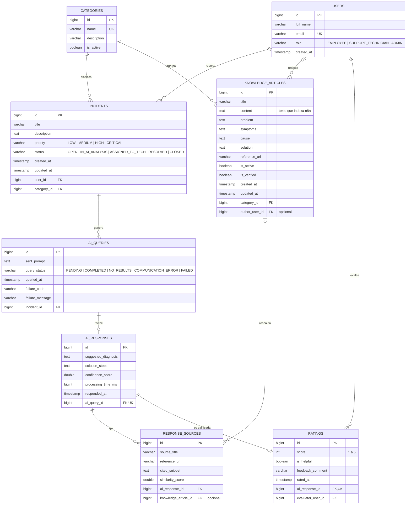
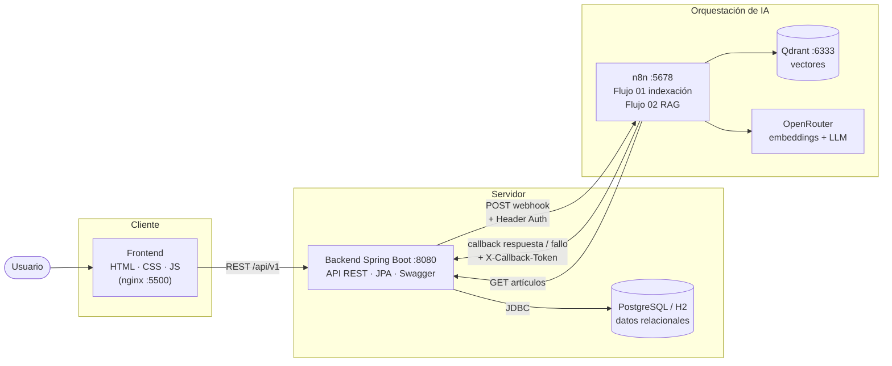
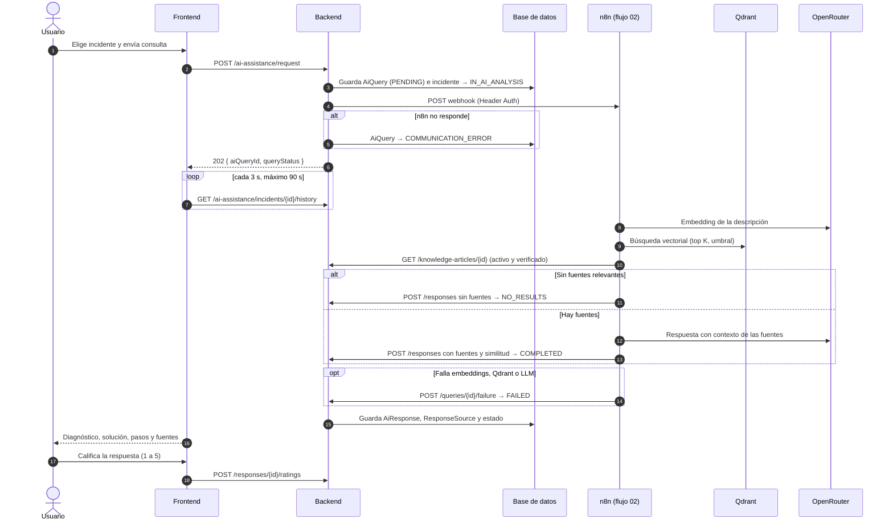
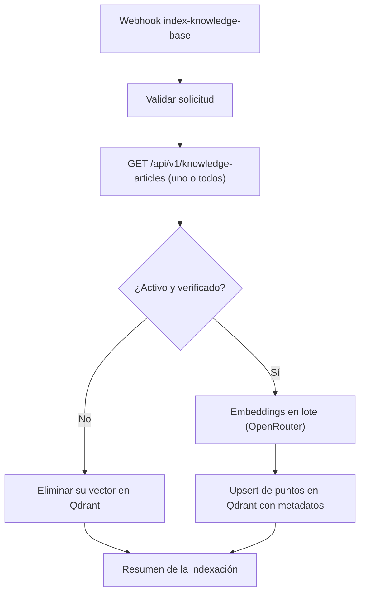

# Diagramas

Los diagramas están escritos en [Mermaid](https://mermaid.js.org/), así que GitHub los muestra directamente. Se generaron a partir del código: entidades JPA en `backend/src/main/java/com/mafe/incidentai/domain/entity` y flujos en `n8n/workflows`.

## 1. Modelo entidad-relación

Reglas de negocio reflejadas en el modelo:

- Un incidente puede tener varias consultas a la IA; cada consulta tiene como máximo **una** respuesta (`ai_query_id` único).
- Cada respuesta tiene como máximo **una** calificación (`ai_response_id` único en `ratings`).
- Una fuente puede apuntar a un artículo de la base de conocimiento. Solo los artículos `is_active` e `is_verified` se usan en el RAG.
- No se registran incidentes ni artículos nuevos en una categoría inactiva, y un incidente `CLOSED` ya no cambia de estado ni se consulta con la IA.

## 2. Arquitectura

El frontend solo se comunica con el backend. Las claves de OpenRouter y Qdrant viven en las credenciales de n8n, y los tokens de integración en variables de entorno.

## 3. Secuencia de una consulta al asistente (RF04, RF05)

## 4. Indexación de la base de conocimiento (RF03)

